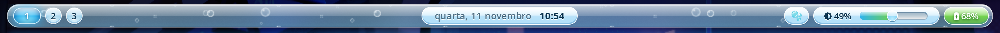
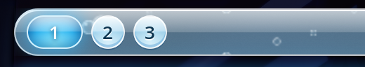
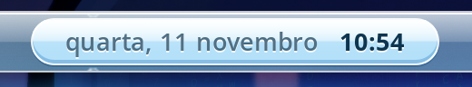
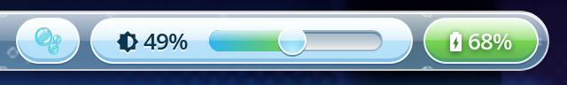
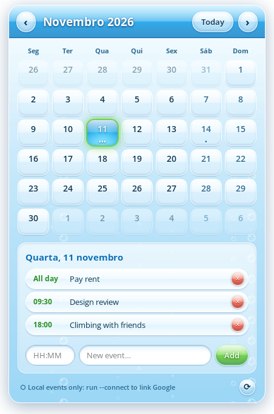

# aero-bar

A [Waybar](https://github.com/Alexays/Waybar) configuration for [Hyprland](https://hypr.land) in the style of **Frutiger Aero**: the glossy, glassy, sky-and-water look of mid-2000s and early-2010s interfaces (Windows Vista / 7 Aero, Web 2.0 gloss).

It's a floating sheet of sky-tinted glass with drifting bubbles behind it, glossy aqua capsules, workspaces drawn as glass bubbles, and a calendar popup with events.



| Workspaces | Date & time | Bubbles toggle · brightness · battery |
|:---:|:---:|:---:|
|  |  |  |

<p align="center">
  
  <br><em>The Aero Calendar popup, opened by clicking the clock</em>
</p>

<sub>Screenshots taken on Hyprland at scale 2 with blur enabled. Date and day names follow the system locale (Portuguese here).</sub>

---

## Contents

- [Design](#design)
- [Features](#features)
- [The bubbles (and their cost)](#the-bubbles-and-their-cost)
- [Installation](#installation)
- [Customising](#customising)
- [Files](#files)
- [References](#references)

---

## Design

Frutiger Aero doesn't have formal rules. It's a set of things that kept showing up in interfaces, ads and wallpapers from about 2004 to 2013. The ones this bar uses:

| Frutiger Aero trait | How the bar uses it |
|---|---|
| **Skeuomorphic gloss**: surfaces look like real glass or acrylic | Every capsule, bubble and button uses the same two-layer "gloss recipe" (below) |
| **Glass and transparency** | The bar is a translucent, sky-tinted sheet that floats over the desktop; with Hyprland blur it becomes frosted glass |
| **Sky, water and nature colours** | Sky blue and aqua for most things, grass green for "good" states (charging, selection, Add), sunshine amber and coral for warnings |
| **Bubbles, water and orbs** | Workspaces are glass bubbles, today's date is an aqua orb, and real bubbles drift through the bar |
| **Round, soft, 3D shapes** | Everything is a pill or a circle, with white rims, inner shading and soft glows |
| **Clean humanist type** (Frutiger, Myriad, Segoe UI) | `Segoe UI`, falling back to `Open Sans` / `Noto Sans` |

### The gloss recipe

Every glossy surface is built from two stacked background layers plus a rim and a shadow:

```css
background-image:
  /* 1. the shine: bright white top half with a hard cut at 50%,
        plus a faint glow at the bottom (light bouncing back up) */
  linear-gradient(to bottom,
    rgba(255,255,255,0.95) 0%,
    rgba(255,255,255,0.45) 48%,
    rgba(255,255,255,0.00) 50%,
    rgba(255,255,255,0.35) 100%),
  /* 2. the colour underneath: sky, aqua or grass */
  linear-gradient(to bottom, #e6f7ff, #8fd0f5);
border: 1px solid rgba(255,255,255,0.9);          /* thin white rim */
box-shadow: inset 0 -2px 0 rgba(20,110,180,0.30),  /* depth at the bottom */
            0 1px 0 rgba(10,70,120,0.35);           /* sits on the glass */
```

The hard cut at 50% is what makes it read as "Aero gloss" instead of a plain gradient. Swap the colour layer to get the other variants: aqua orbs (`radial-gradient` from `#7ee6ff` to `#0b6fb8`), grass green (`#a6ec7c` → `#2c8f22`), amber and coral.

### Palette

| Role | Colour |
|---|---|
| Ink (text) | `#0d3550` |
| Sky (capsules) | `#e6f7ff` → `#8fd0f5` |
| Aqua (active / today) | `#2fb4ef`, deep `#0b6fb8` |
| Grass (charging / selected / add) | `#6fd14a`, deep `#2c8f22` |
| Amber (battery warning) | `#ffc23d` |
| Ember (battery critical / delete) | `#ff5a3c` |

---

## Features

**Left: workspaces as glass bubbles.** There's one bubble for each workspace you have open, so you can count your desktops at a glance. The one you're on becomes a wider, saturated aqua orb with a glow, and urgent workspaces turn into orange orbs. Click a bubble to switch, or scroll over them to cycle.

**Centre: date and time.** It shows the date and time in a glossy capsule, using your system locale. Click it to open the **Aero Calendar** popup:

- A frosted glass panel with a glossy aqua title bar and static bubbles.
- Use ‹ › and **Today** to move between months. Click a day to select it.
- Days with events show up to three dots, and hovering a day lists its events.
- Add events with an optional time (`HH:MM`; leave it empty for all-day) and a title, then press Enter or **Add**. Delete one with ✕.
- Click the clock again or press **Esc** to close.
- Events are stored locally in `~/.local/share/aero-calendar/events.json`.
- **Optional Google Calendar sync** for your primary calendar: see [Google Calendar](#optional-google-calendar).

**Right:**

- **🫧 bubble toggle**: starts or freezes the drifting-bubble animation (see [below](#the-bubbles-and-their-cost)).
- **Brightness**: an icon, the percentage, and a slider. The slider is a recessed glass groove with an aqua-to-grass fill and a glossy pearl knob. Drag it or scroll on the icon.
- **Battery**: a sky capsule normally, glossy green while charging, amber at or below 30%, and coral and pulsing at or below 15%. Hover for time remaining and power draw.

---

## The bubbles (and their cost)

### What they are

Small soap bubbles slowly rise and drift sideways through the glass of the bar. They're visible in the gaps between capsules and pass behind them. There are three depths: near bubbles are bigger and faster and drift right, mid ones drift left, and far ones are faint and slow. The loop lasts 60 seconds and has no visible seam.

### How they work

Waybar can't run code in its own background, so the bubbles are pure GTK CSS:

1. `scripts/make-bubbles.py` uses Cairo to pre-render three **seamlessly tiling PNGs** (`bubbles/near.png`, `mid.png`, `far.png`). Each one is as tall as the bar and holds a few bubbles with a clear centre, a bright rim, a faint aqua tint and a highlight spot. Bubbles that cross a tile edge are drawn on the opposite edge too, so the tiles repeat without seams.
2. `style.css` stacks the three tiles on `window#waybar` and animates `background-position` with `@keyframes`. Each layer's loop ends on a whole multiple of its tile size, so it wraps around invisibly.
3. The animation runs as `steps(1800)` over 60s, which is **30 updates per second**.

### Why it costs CPU

GTK 3 has no compositor-side animation. **Any animated background makes GTK repaint the whole bar in software, every frame**: every gradient, border and shadow of every module. On a HiDPI screen the bar has four times as many pixels to repaint.

These measurements are from one laptop (2880×1800 at 90 Hz, scale 2, Waybar 0.16). They're the CPU use of the waybar process as a percentage of one core:

| Version | CPU |
|---|---|
| First attempt: bubbles drawn as CSS `radial-gradient`s, full frame rate | **80%** |
| Pre-rendered PNG bubbles, full frame rate | 63% |
| PNG bubbles, 30 updates/s, blurred shadows | 42% |
| **PNG bubbles, 30 updates/s, hard-edged shadows (shipped)** | **~34%** |
| PNG bubbles, 20 updates/s, blurred shadows | 31% (hard shadows: lower, not measured) |
| Gradient bubbles at 5 updates/s (cheap, but visibly choppy) | 10% |
| **Bubbles frozen with the 🫧 toggle** | **~1%** |

The things that made the biggest difference:

- **Pre-rendering the bubbles.** Cairo recalculated every `radial-gradient` in every repeated tile on every frame, while copying a PNG is cheap.
- **Lowering the update rate.** The bubbles move only a few pixels per second, so 30 updates/s with sub-pixel image positioning looks smooth, and anything above that is wasted. At about 5 updates/s each jump becomes visible.
- **Avoiding blurred `box-shadow`.** GTK 3 recomputes blurred shadows from scratch on every repaint, which accounted for nearly half the remaining cost. Shadows in the bar use a blur radius of `0`, which is cheap and still gives rims and depth lines. The one exception is the active-workspace glow.

If you use Hyprland blur behind the bar, the compositor also has to re-blur it every frame. That cost lands on the **GPU**, not the CPU.

### How to reduce the cost

From the least to the most change:

1. **Click 🫧** to freeze the bubbles. They stay visible but stop moving, and CPU drops to about 1%. Click it again to resume. The choice is remembered across restarts because it's stored in `bubbles-anim.css`, and toggling reloads waybar's style (you may see a short flicker).
2. **Lower the update rate.** In `scripts/bubbles.sh`, change `steps(1800)` to `steps(1200)` for 20/s or `steps(900)` for 15/s (23% measured with blurred shadows), then toggle twice to apply.
3. **Make the loop slower.** Raise `60s`. The motion gets calmer, though the cost per update stays the same.
4. **Keep shadows hard-edged.** If you add modules, avoid blurred `box-shadow`s (non-zero blur radius) on anything inside the bar.
5. **Freeze them on battery.** For example, use a udev rule or a power-profile hook to run `scripts/bubbles.sh toggle` when the charger is unplugged.
6. **Remove them entirely.** Set `bubbles-anim.css` to `window#waybar { animation: none; }` and drop `custom/bubbles` from `config.jsonc`. The static bubbles cost nothing.

The calendar popup's bubbles are static, so they have no ongoing cost.

---

## Installation

### Requirements

| Needed for | Packages (Arch names) |
|---|---|
| The bar | `waybar` (tested on 0.16), `hyprland` |
| Brightness | `brightnessctl`, a backlight device (`intel_backlight` by default) |
| Icons and fonts | a Nerd Font (`ttf-meslo-nerd` or any other), `noto-fonts-emoji` (🫧), `ttf-opensans` or Segoe UI |
| Calendar popup | `python`, `python-gobject`, `gtk3`, `gtk-layer-shell` |
| Regenerating the bubbles (optional) | `python-cairo` |
| Google Calendar (optional) | `python-google-api-python-client`, `python-google-auth-oauthlib` |

### Install

```sh
git clone https://github.com/DanielaDoesCode/aero-bar.git ~/.config/waybar
# or, if you keep dotfiles elsewhere:
#   git clone https://github.com/DanielaDoesCode/aero-bar.git ~/aero-bar
#   ln -s ~/aero-bar ~/.config/waybar
chmod +x ~/.config/waybar/scripts/*.sh ~/.config/waybar/calendar/aero-calendar.py
```

Then start or restart waybar (`pkill waybar; waybar &`).

Check the two hardware names in `config.jsonc` against your machine:

```sh
ls /sys/class/backlight      # -> "device" in backlight and backlight/slider
ls /sys/class/power_supply   # -> "bat" in battery (e.g. BAT0, BAT1)
```

### Hyprland: real glass blur (recommended)

Without blur the bar is just translucent. With blur it becomes frosted glass. Add a layer rule for the bar and the calendar popup.

`hyprland.lua` (Lua config, Hyprland 0.57+; this is the version I tested):

```lua
hl.layer_rule({
    name         = "aero-glass",
    match        = { namespace = "^(waybar|aero-calendar)$" },
    blur         = true,
    ignore_alpha = 0.2,   -- don't blur the near-transparent shadow margin
})
```

For `hyprland.conf` setups, add the equivalent `layerrule` (blur and ignore_alpha 0.2) for the `waybar` and `aero-calendar` namespaces, using the syntax your Hyprland version expects. I haven't tested that variant.

The bar floats with a 10px margin on each side, so `general.gaps_out = 10` lines your windows up with it.

### Optional: Google Calendar

Once it's linked, the calendar shows your **primary** Google calendar, and events you add or delete are written to Google. Local events stay local.

1. Install `python-google-api-python-client` and `python-google-auth-oauthlib`.
2. In [Google Cloud Console](https://console.cloud.google.com/):
   1. Create a project and enable the **Google Calendar API**.
   2. Configure the **OAuth consent screen** (External) and add yourself as a test user.
   3. Create an **OAuth client ID** of type **Desktop app**, download its JSON, and save it as `~/.config/aero-calendar/credentials.json`.
3. Run `~/.config/waybar/calendar/aero-calendar.py --connect` and sign in from the browser window that opens.

While the consent screen is in **Testing** mode, Google expires the sign-in after 7 days. **Publishing** the app avoids this; you'll get an "unverified app" warning, which is expected for a personal client. The token is stored with `0600` permissions at `~/.config/aero-calendar/token.json`.

---

## Customising

- **Colours**: the palette is defined with `@define-color` at the top of `style.css` and `calendar/style.css`.
- **Bubbles**: edit `LAYERS` in `scripts/make-bubbles.py` (tile width, opacity, and each bubble's position and radius), then run `python3 scripts/make-bubbles.py`. If you change a tile's width, update the matching end offset in `@keyframes aero-bubbles` in `style.css` so the loop stays seamless.
- **Bar height**: if you change `height` in `config.jsonc`, also change `TILE_H` in `make-bubbles.py` (then regenerate) and the `-34px` multiples in `@keyframes aero-bubbles`.
- **Calendar size**: `PANEL_WIDTH` in `calendar/aero-calendar.py` and `button.day` `min-width`/`min-height` in `calendar/style.css`. The panel has a fixed size on purpose, so clicking around never makes it resize and jump.
- **Brightness slider padding**: GTK themes give scales 12px of padding, which forces the bar to grow. `#backlight-slider { padding: 0 4px; }` cancels that out.

---

## Files

```
config.jsonc               modules and their behaviour
style.css                  the bar's look (gloss recipe, palette, bubbles animation)
bubbles-anim.css           on/off state of the bubble animation (imported by style.css,
                           rewritten by the 🫧 toggle; must exist or waybar won't start)
bubbles/{near,mid,far}.png pre-rendered, seamlessly tiling bubble layers
scripts/bubbles.sh         🫧 module: prints status / toggles the animation
scripts/make-bubbles.py    regenerates the bubble PNGs (pycairo)
calendar/aero-calendar.py  the calendar popup (Python, GTK 3, gtk-layer-shell)
calendar/style.css         the popup's look
docs/                      README images
```

---

## References

**On Frutiger Aero:**

- [Frutiger Aero – Aesthetics Wiki](https://aesthetics.fandom.com/wiki/Frutiger_Aero): the motifs (gloss, bubbles, sky, aqua, nature) and the typefaces associated with the style
- [Frutiger Aero – Wikiwand (Wikipedia mirror)](https://wikiwand.com/en/articles/Frutiger_aero): skeuomorphism, glossy textures, vibrant colours, timeline
- [Frutiger Aero: The Future of the 2000s – University of Waterloo Computer Museum](https://uwaterloo.ca/computer-museum/exhibits/frutiger-aero-future-2000s): historical context and Windows Aero's role
- [How to Design Frutiger Aero Aesthetics – BudgetPixel](https://budgetpixel.com/blog/how-to-design-frutiger-aero-aesthetics-glossy-orbs-tropical-fish-and-sky-gradients): glossy orbs and sky gradients in practice

**Technical:**

- [Waybar wiki](https://github.com/Alexays/Waybar/wiki) and its man pages (`man waybar`, `man waybar-hyprland-workspaces`, `man waybar-clock`, `man waybar-backlight-slider`)
- [GTK 3 CSS properties](https://docs.gtk.org/gtk3/css-properties.html): what GTK 3's CSS engine supports (multiple backgrounds, `@keyframes`, `steps()`)
- [gtk-layer-shell](https://github.com/wmww/gtk-layer-shell): anchoring the calendar popup under the bar
- [Hyprland wiki](https://wiki.hypr.land/): layer rules and blur
- [Google Calendar API](https://developers.google.com/calendar/api/guides/overview) (optional sync)

---

Made with [Claude Code](https://claude.com/claude-code).
